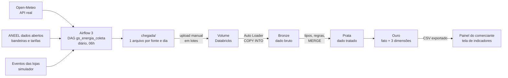

# Energia que dá Lucro · componente Dados

FIAP · Global Solution 2026.2 · CitizenTech · 4ES · **Big Data Architecture & Data Integration**

Pipeline que coleta clima e tarifas reais e os eventos de desperdício das lojas, trata tudo em camadas Bronze, Prata e Ouro e entrega ao painel do comerciante os indicadores que ele vê.

## Integrantes

| Nome completo | RM |
|---|---|
| _preencher_ | _preencher_ |
| _preencher_ | _preencher_ |
| _preencher_ | _preencher_ |
| _preencher_ | _preencher_ |
| _preencher_ | _preencher_ |

## Ficha Técnica do MVP

| Campo | Conteúdo |
|---|---|
| Nome do produto | Energia que dá Lucro _(nome provisório, a confirmar)_ |
| Cidadão e território | Donos e funcionários de pequenos comércios de bairro (mercadinhos, padarias, açougues, lojas) em cidades brasileiras. |
| Problema, em uma frase | O pequeno comerciante paga caro de energia sem saber quais hábitos e equipamentos causam o desperdício. |
| Proposta de valor | Mostrar o desperdício em reais, avisar na hora em que ele acontece e sugerir ações simples, usando as câmeras que a loja já tem. |
| Arquitetura: componentes | Detecção por câmera (Visão) · robô com sensores (Físico) · API e painel do comerciante (Produção) · **pipeline de dados (Dados, este repositório)** · consultor de eficiência com LLM local (Inteligência) · alertas e resumos automáticos (Automação) · modelo de negócio (Pitch). |
| Fontes de dados | Clima (Open-Meteo) · bandeiras tarifárias e tarifas homologadas (dados abertos da ANEEL) · eventos das lojas (simulados, com geração documentada). |
| Modelos de IA utilizados | YOLO treinado para portas de refrigeração abertas · LLM local com base de conhecimento (RAG) · IA embarcada no robô. |
| URL do MVP e repositório | _a definir (entrega de DevOps)_ |
| Indicadores de impacto | R$ e kWh de desperdício evitados por loja ao mês · tempo médio de porta aberta · percentual de alertas resolvidos em poucos minutos · número de lojas ativas. |
| ODS conectados | ODS 9, 11 e 13 (lista do desafio); ODS 7 e 12 são os mais diretos, a confirmar com o professor. |

**Perguntas que o MVP responde ao comerciante, com estes dados**

1. Quanto a minha loja desperdiçou de energia neste mês, em reais e em kWh?
2. Quais equipamentos mais desperdiçam?
3. Em que horários o desperdício se concentra?
4. Dias e horas mais quentes aumentam o desperdício na refrigeração?
5. Quanto deixei de desperdiçar depois que os alertas começaram? _(impacto)_

## Arquitetura



O Databricks Free Edition não se conecta ao Airflow nem ao painel. Por isso há duas trocas por arquivo: `chegada/` sobe ao Volume pela interface, e a visão da Ouro desce em CSV para o painel.

## Fontes de dados

| Fonte | Origem | Tipo | Formato | Frequência | Licença |
|---|---|---|---|---|---|
| Clima por hora | [Open-Meteo](https://open-meteo.com/) `api.open-meteo.com/v1/forecast` | API pública, sem chave | JSON (listas paralelas) | diária, 24 horas por arquivo | CC BY 4.0 |
| Bandeira tarifária acionada | [ANEEL dados abertos](https://dadosabertos.aneel.gov.br/dataset/bandeiras-tarifarias), recurso "Bandeira Tarifária - Acionamento" | base aberta, API CKAN | JSON Lines | diária (a base muda 1 vez por mês) | ODbL |
| Tarifa B3 convencional | [ANEEL dados abertos](https://dadosabertos.aneel.gov.br/dataset/tarifas-distribuidoras-energia-eletrica), recurso "Tarifas homologadas" | base aberta, API CKAN | JSON Lines | diária (muda no reajuste anual) | ODbL |
| Eventos de desperdício | `dags/simulador_eventos.py` | **simulado** | JSON Lines, contrato do grupo | diária | — |
| Cadastro de lojas e equipamentos | `amostras/cadastro/` | fictício | CSV | carga única | — |

As três fontes externas foram testadas em 10/11/2026 e responderam. A tarifa B3 da Enel SP (`ELETROPAULO`) vigente desde 04/07/2026 é TUSD 472,42 + TE 316,96 = **R$ 0,78938/kWh sem tributos** (Resolução Homologatória nº 3.596/2026).

### Por que os eventos são simulados, e como

Não existe API pública com o consumo de energia de um comércio específico. O desafio permite dados simulados com geração justificada e documentada. O simulador segue o contrato de dados do grupo e estas hipóteses, que são suposições e não medições:

| Hipótese | Valor |
|---|---|
| Aberturas de porta por dia | 8 a 16 por expositor, 3 a 7 por freezer |
| Horário das aberturas | perfil com pico às 14h, dentro do horário de funcionamento |
| Duração da porta aberta | log-normal, mediana de 75 s (expositor) e 60 s (freezer), entre 15 s e 30 min |
| Luz acesa sem necessidade | estoque: 1 a 3 vezes ao dia, 10 a 60 min; salão: em metade dos dias, depois de fechar |
| Efeito dos alertas | a partir de 10/11/2026, 70% dos eventos acima de 60 s são encerrados logo após o alerta |
| Registros defeituosos | cerca de 3%, de propósito, para exercitar as regras de qualidade |
| Custo | fórmula do contrato: `potencia_kw × fator_perda × (duracao_s / 3600) × 0,90` |

A geração é determinística por dia: reprocessar um dia produz o mesmo arquivo e os mesmos ids.

## Estrutura do repositório

```
dags/
  gs_energia_coleta.py      DAG diário: 4 coletas em paralelo + conferência
  simulador_eventos.py      gerador dos eventos das lojas
databricks/
  00_setup.sql              esquema e Volume
  01_bronze.py              Auto Loader e COPY INTO, com contagens antes e depois
  02_prata.sql              tipos, regras de qualidade, MERGE
  03_ouro.py                fato, dimensões, LGPD e visão do painel
  04_consultas.sql          as 5 consultas do MVP
  05_exporta_csv_painel.py  CSV da Ouro para o painel
amostras/                   um pouco de cada fonte
relatorio/                  relatório da disciplina (HTML para gerar o PDF)
```

## Como reproduzir

### 1. Coleta no Airflow 3

1. Copie `dags/` para a pasta de DAGs do seu Airflow 3 (os dois arquivos juntos). O worker precisa do pacote `requests`.
2. Em **Admin > Variables**, crie `gs_chegada_dir` com o caminho da pasta de pouso (uma pasta que você consiga abrir depois para fazer o upload). As outras Variables são opcionais:

   | Variable | Padrão | Uso |
   |---|---|---|
   | `gs_chegada_dir` | `../chegada` ao lado de `dags/` | pasta de pouso |
   | `gs_latitude`, `gs_longitude` | `-23.55`, `-46.63` | local das lojas |
   | `gs_distribuidora` | `ELETROPAULO` | sigla da distribuidora na ANEEL |
   | `gs_aneel_recurso_bandeiras`, `gs_aneel_recurso_tarifas` | ids atuais | recursos CKAN da ANEEL |

   Nenhuma fonte exige chave de API. Se uma fonte com chave for adicionada, a chave entra como Variable, nunca no código.
3. Ative o DAG `gs_energia_coleta`. Ele roda todo dia às 06h (Brasília) e coleta o dia anterior. Com `catchup=True`, a primeira ativação preenche os dias desde 01/11/2026.
4. Resultado em `chegada/`: `clima/clima_AAAA-MM-DD.json`, `bandeiras/…`, `tarifas/…` e `eventos/…`, um arquivo por fonte e dia.

### 2. Lakehouse no Databricks Free Edition

1. Importe os arquivos de `databricks/` como notebooks (Workspace > Import).
2. Rode `00_setup`.
3. Envie ao Volume `workspace.energia_lucro.chegada`, pela interface:
   - `cadastro/lojas.csv` e `cadastro/equipamentos.csv` (de `amostras/cadastro/`);
   - **1º lote**: os arquivos de alguns dias, mantendo as subpastas `clima/`, `bandeiras/`, `tarifas/` e `eventos/`.
4. Rode `01_bronze` e guarde as contagens.
5. Envie o **2º lote** (dias diferentes) e rode `01_bronze` de novo: só as linhas novas entram. Rode uma terceira vez sem enviar nada: zero linhas novas.
6. Rode `02_prata`, depois `03_ouro` (preencha o widget `sal_hash`), `04_consultas` e `05_exporta_csv_painel`.
7. Baixe `chegada/_export/indicadores_ouro.csv` do Volume e entregue ao painel.

## Qualidade e idempotência

| Camada | Garantia |
|---|---|
| Bronze | O checkpoint do Auto Loader e o controle do `COPY INTO` registram os arquivos já lidos. Cada execução grava as contagens em `bronze_log_cargas`. |
| Prata | `MERGE` pela chave de cada tabela. Regras de qualidade com o total barrado em `prata_qualidade_log`; eventos barrados ficam em `prata_eventos_rejeitados` com o motivo. |
| Ouro | Refeita a partir da Prata a cada execução. Uma linha por evento, conferida no próprio notebook. |

Regras dos eventos: **R1** duração entre 1 s e 4 h · **R2** loja e equipamento existentes no cadastro · **R3** início válido e não futuro · mais R0 (id nulo), R4 (tipo ou origem fora do contrato) e D1 (id repetido).

## LGPD

- O único dado pessoal do produto é o cadastro do responsável pela loja: nome, e-mail e telefone. Nenhuma imagem de câmera é armazenada; guardamos só os eventos.
- No repositório, o cadastro é **fictício** (`@exemplo.com.br`, telefones `90000-000x`).
- Na Ouro (`dim_loja`), esses campos aparecem só como **hash SHA-256 com sal** e como **máscara**. O sal é informado no widget do notebook e não é versionado.
- A visão consumida pelo painel (`vw_painel_indicadores`) não tem dado pessoal.
- IA responsável: o sistema só avisa; quem decide e age é o comerciante.

## ODS

- **ODS 9** (indústria, inovação e infraestrutura): leva tecnologia de monitoramento, antes restrita a grandes redes, ao pequeno comércio.
- **ODS 11** (cidades e comunidades sustentáveis): reduz o consumo de energia do comércio de bairro, que sustenta a vida local.
- **ODS 13** (ação contra a mudança do clima): menos energia desperdiçada significa menos emissões associadas à geração.
- ODS 7 (energia acessível e limpa, meta 7.3 de eficiência) e ODS 12 (consumo responsável) são os mais diretos; a citação depende de confirmação com o professor, por não estarem na lista do desafio.

## Limitações conhecidas

- Os eventos das lojas são simulados. As consultas mostram como cada pergunta é respondida; os valores refletem as hipóteses do simulador.
- Os parâmetros de potência e perda são provisórios (contrato do grupo) e os de iluminação são suposição desta entrega.
- `custo_aneel_rs` usa a tarifa homologada, sem tributos.
